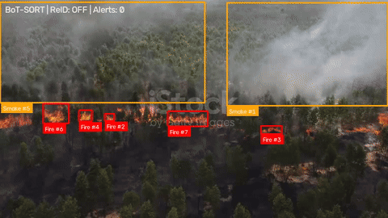
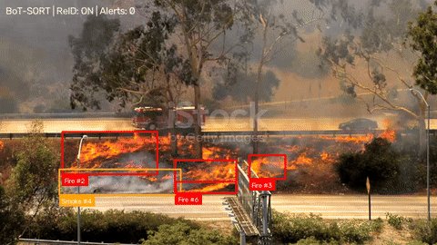
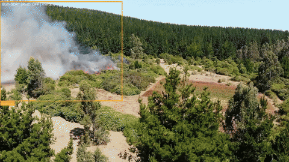
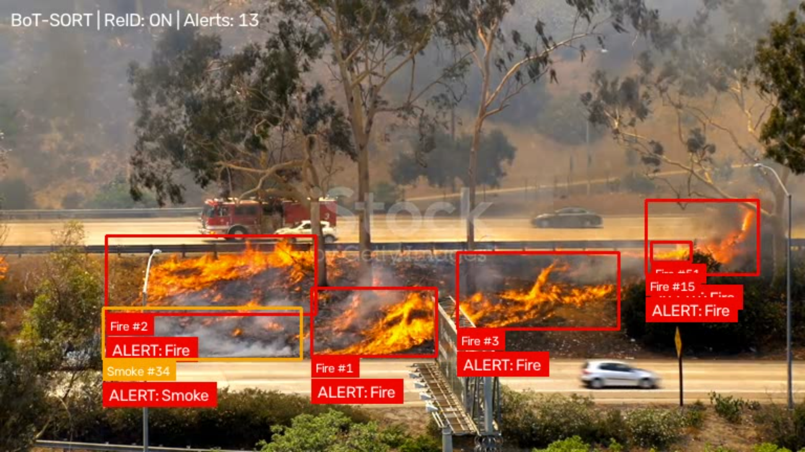
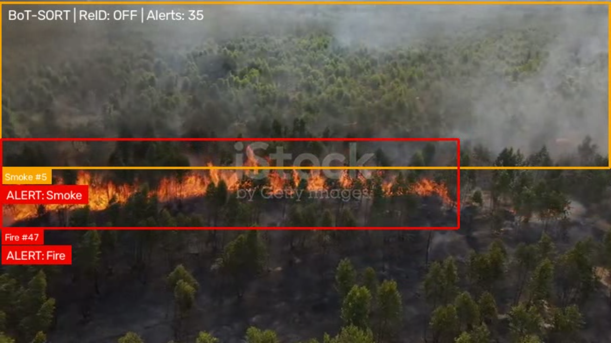
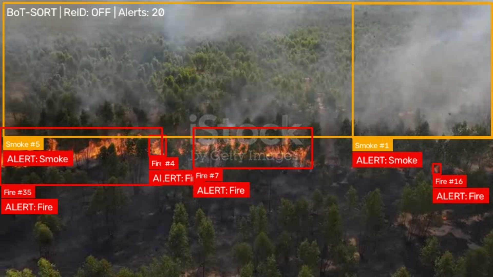
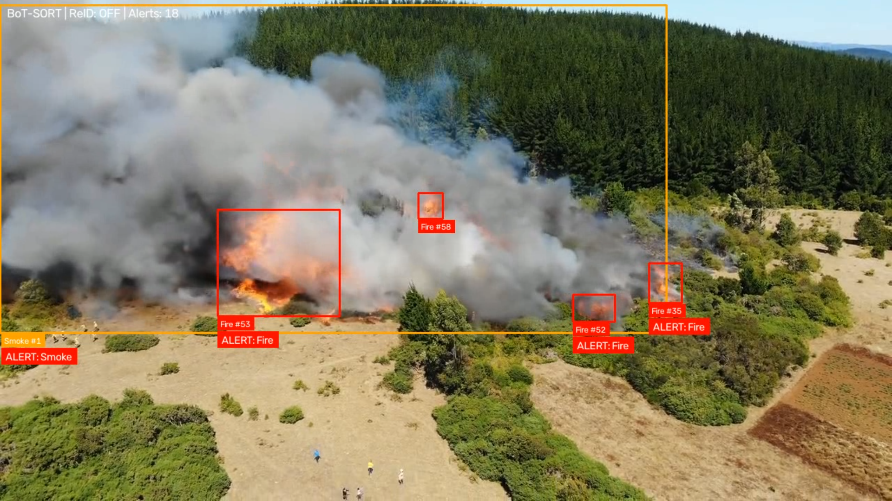

# 🔥 Fire and Smoke Detection

## Sample Output Videos







## Sample Images

| Sample 1 | Sample 2 |
| --- | --- |
|  |  |
|  |  |

A video-based **Fire and Smoke Detection and Tracking System** designed for real-time deployment scenarios, based on **YOLOv8m**, trained on the **D-Fire dataset**, with **BoT-SORT multi-object tracking**, **ONNX Runtime deployment**, configurable confidence thresholds, and a temporal alert mechanism. Real-time performance depends on the input video, processing settings, and available hardware.

The system detects **Fire** and **Smoke** in video streams, assigns persistent tracking IDs to detected objects, and triggers an alert when the same tracked object remains visible for **5 consecutive frames**.

The project also includes the complete training pipeline, PyTorch and ONNX model versions, evaluation results, confidence-threshold analysis, Docker deployment, and GPU/CPU inference support.

## Sample Output Videos (DEMO)

The repository includes three sample output videos generated after processing input videos with the trained model:

- `sample1.mp4`
- `sample2.mp4`
- `sample3.mp4`

These files are provided as examples of the model's output. They show the annotated video produced by the pipeline, including Fire and Smoke detections, BoT-SORT tracking IDs, runtime status, and alert overlays when the same tracked object remains visible for five consecutive frames.

To create a new output video, provide a separate input video and an output path:

```powershell
python main.py 1.mp4 output_video1.mp4
```

---

## 🚀 Features

* 🔥 Fire detection
* 💨 Smoke detection
* 🎯 YOLOv8m object detection
* 🆔 Persistent object tracking using BoT-SORT
* ⏱️ Temporal alert mechanism based on consecutive frames
* 🚨 Alert after 5 consecutive frames
* 🧠 Optional BoT-SORT ReID support
* ⚡ ONNX Runtime inference
* 🎮 CUDA GPU acceleration
* 💻 CPU fallback
* 📦 Docker deployment
* 📊 PyTorch vs ONNX evaluation
* 📈 Confidence-threshold evaluation
* 📉 Precision, Recall, mAP50 and mAP50-95 evaluation
* 🔍 Per-class evaluation for Fire and Smoke
* 🎥 Annotated MP4 output
* 🖥️ Terminal-based runtime monitoring
* 📊 Real-time processing statistics
* 💾 Automatic checkpoint backup during training
* ☁️ Google Drive checkpoint synchronization
* 🔁 Reproducible training with fixed random seed
* 🧪 AMP-enabled training
* 🛠️ Configurable inference parameters

---

# 📁 Project Structure

```text
Fire-Smoke-Detection/
│
├── main.py
├── Dockerfile
├── requirements.txt
│
├── fire_smoke_training/
│   ├── best.pt
│   └── best.onnx
│
├── train_code/
│   ├── train.py
│   └── export_onnx.py
│
├── train_result/
│   │
│   ├── train_result_with_pt/
│   │   ├── results/
│   │   ├── test_results/
│   │   ├── threshold_results/
│   │   └── threshold_comparison.csv
│   │
│   └── ...
│
├── train_result_with_pt/
│   ├── val/
│   ├── test/
│   └── metrics_summary.json
│
├── train_result_with_onnx/
│   ├── val/
│   ├── test/
│   └── metrics_summary.json
│
├── sample1.mp4                    # Sample annotated output video
├── sample2.mp4                    # Sample annotated output video
├── sample3.mp4                    # Sample annotated output video
└── *.mp4                          # Other input/output videos
```

`train_result/` contains the training and evaluation artifacts produced and collected during the YOLO workflow. The `train_result_with_pt/` and `train_result_with_onnx/` directories were created after training for the final validation and test evaluation of the PyTorch and ONNX models, respectively, and for comparing the differences between both formats.

The dataset itself is not included in the repository. Place the downloaded Kaggle dataset under `dataset/` with this structure:

```text
dataset/
├── data.yaml
└── data/
   ├── train/
   │   ├── images/
   │   └── labels/
   ├── val/
   │   ├── images/
   │   └── labels/
   └── test/
      ├── images/
      └── labels/
```

### Main Components

| File / Directory                | Description                                                                        |
| ------------------------------- | ---------------------------------------------------------------------------------- |
| `main.py`                       | Main ONNX video detection, tracking and alert pipeline                             |
| `Dockerfile`                    | CUDA-enabled Docker deployment configuration                                       |
| `requirements.txt`              | Python dependencies                                                                |
| `fire_smoke_training/best.pt`   | Best PyTorch model checkpoint                                                      |
| `fire_smoke_training/best.onnx` | Exported ONNX model                                                                |
| `train_code/train.py`           | YOLOv8m training pipeline                                                          |
| `train_code/export_onnx.py`     | Converts `best.pt` to the deployed `best.onnx` model                              |
| `train_result/`                 | Training and evaluation artifacts                                                  |
| `train_result_with_pt/`         | PyTorch evaluation results                                                         |
| `train_result_with_onnx/`       | ONNX evaluation results                                                            |
| `train_result/train_result_with_pt/threshold_results/` | Evaluation results across multiple confidence thresholds |
| `train_result/train_result_with_pt/threshold_comparison.csv` | Numerical comparison of threshold experiments |
| `*.mp4`                         | Input/output video examples                                                        |

---

# 🎥 Application Interface and Workflow

The application does not use a traditional web-based GUI.

The main interface consists of:

1. **Annotated output video**
2. **Terminal runtime information**
3. **Detection and tracking information**
4. **Temporal alert visualization**
5. **GPU / CUDA / ONNX Runtime status**

The system processes the input video frame by frame.

---

## 🔄 Processing Workflow

```text
Input Video
     │
     ▼
OpenCV VideoCapture
     │
     ▼
Read Video Frame
     │
     ▼
YOLOv8m ONNX Model
     │
     ├── Smoke
     └── Fire
     │
     ▼
Confidence Filtering
     │
     ▼
BoT-SORT Tracking
     │
     ▼
Persistent Track ID
     │
     ▼
Consecutive Frame Counter
     │
     ├── < 5 frames
     │       │
     │       ▼
     │   Normal Detection
     │
     └── ≥ 5 frames
             │
             ▼
        🚨 ALERT
             │
             ▼
Annotated Output Video
```

---

## 1. GPU and Runtime Environment Check

At startup, the application prints the available execution environment.

The program reports:

* PyTorch version
* CUDA availability
* GPU name
* CUDA version
* CUDA device count
* Current CUDA device
* CUDA memory allocated
* CUDA memory reserved
* ONNX Runtime version
* Available ONNX Runtime providers

Example:

```text
======================================================================
GPU ENVIRONMENT
======================================================================

PyTorch version       : ...
CUDA available        : True
GPU                   : NVIDIA GeForce GTX 1660 Ti
CUDA version          : ...
CUDA device count    : 1
Current CUDA device  : 0
CUDA memory allocated: ... MB
CUDA memory cached   : ... MB

ONNX Runtime version  : ...
ONNX Runtime providers: [...]
```

The application checks whether `CUDAExecutionProvider` is available.

If CUDA is available, GPU inference is requested.

Otherwise, the application falls back to CPU inference.

---

# 🧠 2. Model Loading

The inference model is:

```text
fire_smoke_training/best.onnx
```

The model is loaded through Ultralytics:

```python
model = YOLO(ONNX_MODEL_PATH)
```

The inference configuration is:

| Parameter            |                Value |
| -------------------- | -------------------: |
| Model                |              YOLOv8m |
| Format               |                 ONNX |
| Image Size           |            768 × 768 |
| Confidence Threshold |                 0.35 |
| IoU Threshold        |                 0.45 |
| Maximum Detections   |                  300 |
| Tracker              |             BoT-SORT |
| ReID                 |  Disabled by default |
| Alert Threshold      | 5 consecutive frames |

---

# 🏷️ 3. Class Mapping

The model uses two classes:

| Class ID | Class |
| -------: | ----- |
|      `0` | Smoke |
|      `1` | Fire  |

The mapping is explicitly defined in `main.py`:

```python
CLASS_NAMES = {
    0: "Smoke",
    1: "Fire"
}
```

Only these two classes are passed to the detector:

```python
TARGET_CLASSES = [0, 1]
```

---

# 🎯 4. Object Detection

For every frame, the model performs detection using:

```python
results = model.track(
    frame,
    persist=True,
    conf=CONF_THRESHOLD,
    iou=IOU_THRESHOLD,
    imgsz=IMGSZ,
    tracker=CUSTOM_TRACKER_PATH,
    classes=TARGET_CLASSES,
    max_det=MAX_DET,
    verbose=False,
    device=device
)
```

The detector applies:

* Confidence filtering
* IoU filtering
* Class filtering
* Maximum detection filtering
* 768 × 768 inference resolution

---

# 🆔 5. BoT-SORT Tracking

After detection, **BoT-SORT** is used to associate detections between consecutive frames.

Tracking is enabled with:

```python
persist=True
```

Each detected object receives a tracking ID.

For example:

```text
Fire #3
Smoke #7
```

The number after `#` is the BoT-SORT tracking ID.

This allows the application to distinguish between different Fire or Smoke objects across frames.

---

# 🎨 Detection Overlay

The output video contains visual information directly on each detected object.

### Fire

Fire detections use a **red bounding box and red label background**.

```text
Fire #3
```

### Smoke

Smoke detections use an **orange bounding box and orange label background**.

```text
Smoke #7
```

The label contains:

```text
<Class> #<Track ID>
```

For example:

```text
Fire #1
Fire #3
Smoke #5
```

The class and tracking ID therefore remain visible in the generated video.

---

# 🚨 Alert Condition

The system does not immediately generate an alert when Fire or Smoke is detected.

Instead, it uses a temporal condition.

A tracked object must remain visible for:

```python
FRAME_THRESHOLD = 5
```

consecutive frames.

Therefore:

```text
Frame 101 → Fire #3
Frame 102 → Fire #3
Frame 103 → Fire #3
Frame 104 → Fire #3
Frame 105 → Fire #3
                 │
                 ▼
              ALERT
```

This reduces alerts caused by short-lived detections or isolated false positives.

---

## Alert Logic

For every tracking ID, the application maintains a consecutive-frame counter.

If the object was visible in the previous frame:

```python
consecutive_frames[track_id] += 1
```

Otherwise:

```python
consecutive_frames[track_id] = 1
```

When the counter reaches five:

```python
if consecutive_frames[track_id] >= FRAME_THRESHOLD:
```

an alert is generated.

---

# 🔒 Duplicate Alert Prevention

The system keeps track of already-alerted objects using:

```python
alerted_tracks = set()
```

Once an object has triggered an alert, its tracking ID is added to this set.

Therefore the same tracking ID does not repeatedly generate a new alert on every subsequent frame.

The alert is triggered once per tracked object.

---

# 🖥️ Terminal Alert

When an alert is triggered, the terminal prints information such as:

```text
[ALERT] Frame 245: Fire detected for 5 consecutive frames (Track ID: 3, Conf: 0.82)
```

The alert contains:

* Frame number
* Detection class
* Required consecutive-frame count
* Track ID
* Detection confidence

---

# 🚨 Alert Visualization

Once a tracked object has triggered an alert, the output video displays:

```text
ALERT: Fire
```

or:

```text
ALERT: Smoke
```

The alert is rendered using a **red background with white text**.

The alert is positioned below the object label when there is sufficient space.

---

# 📊 Runtime Status

The top-left area of the output video displays the current tracking configuration and alert count.

Example:

```text
BoT-SORT | ReID: OFF | Alerts: 2
```

This provides real-time information about:

* Tracking algorithm
* ReID status
* Number of triggered alerts

---

# 📈 Detection Statistics

The application maintains detection statistics for each class.

At the end of inference, it reports:

```text
DETECTION STATISTICS BY CLASS:

  Smoke (Class 0): ... detections, ... alerts
  Fire (Class 1): ... detections, ... alerts
```

It also reports:

```text
Total detections
Total alerts
Frames processed
BoT-SORT ReID status
```

If alerts were triggered, the application lists the corresponding tracking IDs:

```text
ALERT TRIGGERED FOR TRACKS:

  - Track ID 3: Fire
  - Track ID 7: Smoke
```

If no object satisfies the temporal condition:

```text
No alerts triggered. No fire or smoke satisfied the temporal alert condition.
```

---

# 🎥 Output Video

The application reads the input video using OpenCV and creates an annotated MP4 output.

The output preserves:

* Original video resolution
* Original FPS
* Detection bounding boxes
* Class labels
* Track IDs
* Alert visualization
* Runtime status

The video writer uses:

```python
mp4v
```

---

# ⚙️ Inference Configuration

The main inference parameters can be modified directly in `main.py`.

```python
CONF_THRESHOLD = 0.35
IMGSZ = 768
IOU_THRESHOLD = 0.45
MAX_DET = 300

TARGET_CLASSES = [0, 1]

USE_REID = False
FRAME_THRESHOLD = 5
```

### Parameter Explanation

| Parameter         | Description                                        |
| ----------------- | -------------------------------------------------- |
| `CONF_THRESHOLD`  | Minimum detection confidence                       |
| `IMGSZ`           | YOLO inference resolution                          |
| `IOU_THRESHOLD`   | IoU threshold used during detection                |
| `MAX_DET`         | Maximum number of detections per frame             |
| `TARGET_CLASSES`  | Classes processed by the detector                  |
| `USE_REID`        | Enables/disables BoT-SORT ReID                     |
| `FRAME_THRESHOLD` | Number of consecutive frames required for an alert |

---

# 🧠 ReID Configuration

BoT-SORT ReID is configurable through:

```python
USE_REID = False
```

By default:

```text
ReID: OFF
```

The application dynamically creates:

```text
custom_botsort.yaml
```

based on the BoT-SORT configuration shipped with the installed Ultralytics package.

When ReID is enabled, the configuration also sets:

```text
model: auto
```

This allows the tracker to use the configured ReID mechanism.

ReID is disabled by default because the current deployment prioritizes a lighter tracking pipeline.

---

# ▶️ Direct Execution

The application accepts input and output video paths through command-line arguments.

Default input:

```text
input_video.mp4
```

Example:

```bash
python main.py input_video.mp4 output.mp4
```

The general syntax is:

```bash
python main.py <input_video> <output_video>
```

For example:

```bash
python main.py fire_test.mp4 fire_result.mp4
```

The application automatically creates the output directory if it does not already exist.

---

# 🐳 Docker

The project includes a Docker configuration for reproducible deployment.

The Docker environment is designed for:

* Python
* PyTorch
* CUDA
* cuDNN
* ONNX Runtime
* OpenCV
* FFmpeg
* Ultralytics

The Docker image uses a CUDA 12.8 + cuDNN environment.

---

## Docker Build

Build the image:

```bash
docker build -t fire-smoke .
```

---

## Docker GPU Inference

On Windows PowerShell:

```powershell
docker run --gpus all --rm `
  -v "${PWD}:/app" `
  fire-smoke python3 main.py 1.mp4 output_video_docker.mp4
```

On Linux:

```bash
docker run --gpus all --rm \
  -v "$(pwd):/app" \
  fire-smoke python3 main.py 1.mp4 output_video_docker.mp4
```

This exposes the NVIDIA GPU to the container.

GPU execution requires:

* NVIDIA GPU
* NVIDIA driver
* Docker GPU support
* Compatible CUDA environment

---

## Docker CPU Inference

CPU inference can also be performed without GPU access.

On Windows PowerShell:

```powershell
docker run --rm `
  -v "${PWD}:/app" `
  fire-smoke python3 main.py 1.mp4 output_video_cpu.mp4
```

On Linux:

```bash
docker run --rm \
  -v "$(pwd):/app" \
  fire-smoke python3 main.py 1.mp4 output_video_cpu.mp4
```

The application automatically falls back to CPU when CUDA is unavailable.

---

# 🧪 Model Training

The detection model was trained using:

```text
YOLOv8m
```

on the:

```text
Smoke-Fire-Detection-YOLO Dataset
```

The dataset was obtained from Kaggle:

> [Smoke-Fire-Detection-YOLO Dataset on Kaggle](https://www.kaggle.com/datasets/sayedgamal99/smoke-fire-detection-yolo)

This Kaggle dataset is an enhanced YOLO-format version of the D-Fire dataset and contains annotations for two classes:

| Class ID | Class |
|---:|---|
| `0` | Smoke |
| `1` | Fire |

It is organized into `train/`, `val/`, and `test/` splits, each with `images/` and `labels/` directories. The same dataset was used for model training and for the validation, test, and confidence-threshold evaluations described below.

The training pipeline is located at:

```text
train_code/train.py
```

---

# 🏗️ Training Pipeline

```text
D-Fire Dataset
      │
      ▼
Dataset YAML
      │
      ▼
YOLOv8m Pretrained Model
      │
      ▼
Training
      │
      ├── Data Augmentation
      ├── AdamW Optimizer
      ├── Cosine LR
      ├── AMP
      ├── Mosaic
      └── Early Stopping
      │
      ▼
Validation
      │
      ▼
Best Checkpoint
      │
      ├── best.pt
      └── last.pt
      │
      ▼
Google Drive Backup
```

---

# ⚙️ Training Configuration

The training configuration used in `train.py` is:

| Parameter       |        Value |
| --------------- | -----------: |
| Base Model      | `yolov8m.pt` |
| Image Size      |        `768` |
| Epochs          |        `120` |
| Batch Size      |         `16` |
| Device          |          `0` |
| Workers         |          `8` |
| Optimizer       |        AdamW |
| Initial LR      |      `0.001` |
| Final LR Factor |       `0.01` |
| Weight Decay    |      `0.001` |
| Cosine LR       |      Enabled |
| Warmup Epochs   |          `3` |
| Patience        |         `20` |
| AMP             |      Enabled |
| Cache           |     Disabled |
| Seed            |         `42` |
| Dropout         |       `0.10` |
| Mosaic          |        `1.0` |
| Close Mosaic    |         `10` |

---

# 🔀 Data Augmentation

The training pipeline uses the following augmentations:

```text
HSV-H          = 0.015
HSV-S          = 0.7
HSV-V          = 0.4

Rotation       = 5°
Translation    = 0.10
Scale          = 0.50
Shear          = 2°
Horizontal Flip = 0.5

Vertical Flip  = 0
Perspective    = 0
MixUp          = 0
Copy-Paste     = 0

Mosaic         = 1.0
Close Mosaic   = 10
```

These augmentations are designed to improve robustness to variations in:

* Lighting
* Object scale
* Camera position
* Orientation
* Scene composition

---

# 🔁 Reproducibility

The training script uses a fixed random seed:

```python
SEED = 42
```

The seed is applied to:

```python
random
numpy
torch
CUDA
```

when CUDA is available.

This improves training reproducibility across runs.

---

# 💾 Checkpoint Management

The training pipeline saves both:

```text
best.pt
last.pt
```

The checkpoints are copied to Google Drive during training.

The callback:

```python
save_checkpoints_to_drive()
```

copies the current checkpoints after model-save events.

The final training stage also performs a final checkpoint copy.

Therefore the project maintains:

```text
Best model
Last model
```

separately.

The deployed model is:

```text
fire_smoke_training/best.onnx
```

The PyTorch checkpoint used for export is:

```text
fire_smoke_training/best.pt
```

## Exporting the ONNX Model

The ONNX export code is located at:

```text
train_code/export_onnx.py
```

Run it from the project root after confirming that `fire_smoke_training/best.pt` exists:

```powershell
python train_code/export_onnx.py
```

The current export configuration uses `opset=12`, `simplify=True`, `dynamic=False`, and `half=False`. Therefore, the script exports a `768 × 768` ONNX model with opset `12`, a simplified graph, static input dimensions, and FP32 precision. The generated model is saved as:

```text
fire_smoke_training/best.onnx
```

---


# 📊 Evaluation Results

The trained model was evaluated using both:

* PyTorch weights
* ONNX weights

The evaluation includes:

* Precision
* Recall
* mAP50
* mAP50-95
* Per-class metrics
* Validation results
* Test results
* Confidence-threshold analysis

The evaluation artifacts are organized under:

```text
train_result/train_result_with_pt/
```

and:

```text
train_result_with_pt/
train_result_with_onnx/
```

The two model-specific directories contain the standard validation and test metrics. The nested `train_result/train_result_with_pt/` directory contains the additional PyTorch evaluation artifacts and confidence-threshold analysis.

---

# 📁 Contents of `train_result/`

| Directory / File           | Description                                                    |
| -------------------------- | -------------------------------------------------------------- |
| `train_result_with_pt/results/`                 | Main PyTorch evaluation plots, labels, curves, and CSV results |
| `train_result_with_pt/test_results/`            | Test visual results, confusion matrices, and prediction outputs |
| `train_result_with_pt/threshold_results/`       | Evaluation plots across multiple confidence thresholds        |
| `train_result_with_pt/threshold_comparison.csv` | Numerical comparison of validation and test metrics at different thresholds |

The evaluation results include information such as:

* Precision
* Recall
* mAP50
* mAP50-95
* F1 score
* Precision-Recall curves
* Confusion matrices
* Prediction visualizations

---

# 🎯 Confidence Threshold Evaluation

A dedicated threshold evaluation was performed to analyze how the confidence threshold affects model performance.

The results are stored in:

```text
train_result/train_result_with_pt/threshold_results/
```

The numerical comparison is stored in:

```text
train_result/train_result_with_pt/threshold_comparison.csv
```

The standard model-specific evaluation results are stored in:

```text
train_result_with_pt/
train_result_with_onnx/
```

Each of these directories contains `val/` and `test/` outputs, `metrics_summary.json`, `data.yaml`, and a `metrics_comparison.png` summary plot. The `val/` and `test/` folders contain the corresponding `metrics.json` and `metrics.csv` files together with the plots generated during evaluation.

This analysis makes it possible to study the trade-off between:

```text
False Positives
        ↕
Detection Sensitivity
```

and select an appropriate confidence threshold for deployment.

The production inference configuration currently uses:

```python
CONF_THRESHOLD = 0.35
```

---

# 🧪 PyTorch vs ONNX Evaluation

The trained PyTorch model and exported ONNX model were evaluated independently.

## Validation Results

| Metric    | PyTorch |  ONNX | Difference |
| --------- | ------: | ----: | ---------: |
| Precision |   0.798 | 0.793 |     -0.005 |
| Recall    |   0.728 | 0.724 |     -0.004 |
| mAP50     |   0.787 | 0.783 |     -0.004 |
| mAP50-95  |   0.465 | 0.457 |     -0.008 |

The ONNX model preserves the validation performance very closely.

---

# 🧪 Test Results

| Metric    | PyTorch |  ONNX | Difference |
| --------- | ------: | ----: | ---------: |
| Precision |   0.787 | 0.789 |     +0.002 |
| Recall    |   0.736 | 0.734 |     -0.002 |
| mAP50     |   0.789 | 0.781 |     -0.008 |
| mAP50-95  |   0.454 | 0.445 |     -0.009 |

The overall test degradation is very small:

* mAP50: **0.8 percentage points**
* mAP50-95: **0.9 percentage points**

This indicates that ONNX conversion preserved the detection accuracy very closely.

---

# 🔍 Per-Class Test Results

## Smoke

| Metric    | PyTorch |  ONNX | Difference |
| --------- | ------: | ----: | ---------: |
| Precision |   0.843 | 0.836 |     -0.007 |
| Recall    |   0.805 | 0.799 |     -0.006 |
| mAP50     |   0.854 | 0.845 |     -0.009 |
| mAP50-95  |   0.524 | 0.513 |     -0.011 |

## Fire

| Metric    | PyTorch |  ONNX | Difference |
| --------- | ------: | ----: | ---------: |
| Precision |   0.731 | 0.742 |     +0.011 |
| Recall    |   0.667 | 0.670 |     +0.003 |
| mAP50     |   0.723 | 0.717 |     -0.006 |
| mAP50-95  |   0.385 | 0.378 |     -0.007 |

The model performs better on the **Smoke** class than on the **Fire** class.

This difference is reflected in the per-class mAP results.

---

# 📌 ONNX Accuracy Conclusion

The ONNX model maintains almost the same detection quality as the original PyTorch model.

The overall test metrics show only a small difference after conversion:

```text
Test mAP50:
PyTorch = 0.789
ONNX    = 0.781
Drop    = 0.008
```

```text
Test mAP50-95:
PyTorch = 0.454
ONNX    = 0.445
Drop    = 0.009
```

Therefore, the ONNX model is suitable for deployment while preserving nearly the same predictive performance.


 ONNX was selected for the deployment pipeline because it provides a standardized model representation and is suitable for deployment through ONNX Runtime across different environments.


---

# 🤖 BoT-SORT Configuration

The tracker is based on the Ultralytics BoT-SORT configuration.

The project creates:

```text
custom_botsort.yaml
```

at runtime by reading the installed Ultralytics BoT-SORT configuration and updating the ReID setting. This file is a runtime-generated artifact and is not stored in the repository.

### Runtime-Generated Files

`custom_botsort.yaml` is automatically generated at runtime from the BoT-SORT configuration provided by the installed Ultralytics package. It is rewritten each time `main.py` starts, so the source of truth is the installed Ultralytics configuration together with the `USE_REID` setting in `main.py`.

The relevant deployment configuration is:

```text
Tracker: BoT-SORT
ReID: OFF
```

ReID can be enabled through:

```python
USE_REID = True
```

---

# ⏱️ Temporal Tracking Logic

The alert mechanism combines object detection with tracking.

Instead of treating every frame independently:

```text
Frame 1 → Detection
Frame 2 → Detection
Frame 3 → Detection
```

the system associates detections using:

```text
Track ID
```

and monitors the object's temporal persistence.

Example:

```text
Smoke #7
   │
   ├── Frame 200
   ├── Frame 201
   ├── Frame 202
   ├── Frame 203
   └── Frame 204
          │
          ▼
       ALERT
```

This makes the final decision depend not only on spatial detection but also on temporal consistency.

---

# 🧩 System Architecture

The overall project can be summarized as:

```text
                  ┌─────────────────────┐
                  │     D-Fire Dataset  │
                  └──────────┬──────────┘
                             │
                             ▼
                  ┌─────────────────────┐
                  │      YOLOv8m        │
                  │      Training       │
                  └──────────┬──────────┘
                             │
                             ▼
                     ┌──────────────┐
                     │    best.pt   │
                     └──────┬───────┘
                            │
                            ▼
                     ┌──────────────┐
                     │  ONNX Export │
                     └──────┬───────┘
                            │
                            ▼
                     ┌──────────────┐
                     │   best.onnx  │
                     └──────┬───────┘
                            │
                            ▼
             ┌─────────────────────────────┐
             │       ONNX Runtime          │
             │       CUDA / CPU            │
             └──────────────┬──────────────┘
                            │
                            ▼
                     ┌──────────────┐
                     │   YOLOv8m    │
                     │   Detection  │
                     └──────┬───────┘
                            │
                            ▼
                     ┌──────────────┐
                     │   BoT-SORT   │
                     │   Tracking   │
                     └──────┬───────┘
                            │
                            ▼
                  ┌─────────────────────┐
                  │ Consecutive Frames  │
                  │     ≥ 5 Frames      │
                  └──────────┬──────────┘
                             │
                             ▼
                      ┌─────────────┐
                      │    ALERT    │
                      └──────┬──────┘
                             │
                             ▼
                   ┌───────────────────┐
                   │ Annotated MP4     │
                   └───────────────────┘
```

---

# 🛠️ Troubleshooting

## CUDA is not available

If the application reports:

```text
CUDA available : False
```

inference will automatically run on CPU.

Check:

```bash
python -c "import torch; print(torch.cuda.is_available())"
```

---

## ONNX CUDA Provider is unavailable

The application checks:

```python
CUDAExecutionProvider
```

If it is unavailable, ONNX Runtime may fall back to another execution provider.

Check the installed providers with:

```python
import onnxruntime as ort
print(ort.get_available_providers())
```

A CUDA-enabled environment should include:

```text
CUDAExecutionProvider
```

---

## Model Not Found

If the application reports:

```text
ONNX model not found
```

verify that:

```text
fire_smoke_training/best.onnx
```

exists relative to the project directory.

---

## Video Not Found

Verify the input video path:

```bash
python main.py input_video.mp4 output.mp4
```

The input file must exist before inference starts.

---

## BoT-SORT Configuration Not Found

The application expects the installed Ultralytics package to contain its default BoT-SORT configuration.

If the configuration is missing, the program raises an error instead of silently continuing with an invalid tracker configuration.

---

# 📌 Current Deployment Configuration

The current production inference configuration is:

```text
Model              : YOLOv8m ONNX
Input               : Video
Classes             : Fire, Smoke
Image Size          : 768 × 768
Confidence          : 0.35
IoU                 : 0.45
Max Detections      : 300
Tracker             : BoT-SORT
ReID                : Disabled
Alert Threshold     : 5 consecutive frames
Output              : MP4
Execution           : CUDA / CPU fallback
```

---

# 📊 Project Summary

| Component               | Technology   |
| ----------------------- | ------------ |
| Programming Language    | Python       |
| Deep Learning Framework | PyTorch      |
| Object Detection        | YOLOv8m      |
| Dataset                 | [Smoke-Fire-Detection-YOLO on Kaggle](https://www.kaggle.com/datasets/sayedgamal99/smoke-fire-detection-yolo) |
| Object Tracking         | BoT-SORT     |
| Deployment Format       | ONNX         |
| Inference Runtime       | ONNX Runtime |
| GPU Acceleration        | CUDA         |
| Video Processing        | OpenCV       |
| Containerization        | Docker       |
| Training Platform       | Google Colab |
| Checkpoint Storage      | Google Drive |
| Output Format           | MP4          |

---

# 🎯 Key Results

The project demonstrates a complete Computer Vision pipeline from training to deployment:

```text
Dataset
   ↓
Model Training
   ↓
Validation
   ↓
Testing
   ↓
Threshold Analysis
   ↓
PyTorch Model
   ↓
ONNX Conversion
   ↓
ONNX Evaluation
   ↓
BoT-SORT Tracking
   ↓
Temporal Alert System
   ↓
Docker Deployment
```

The final ONNX model achieves:

```text
Test Precision   : 0.789
Test Recall      : 0.734
Test mAP50       : 0.781
Test mAP50-95    : 0.445
```

while maintaining accuracy very close to the original PyTorch model.

---

# 🔬 Engineering Highlights

This project is not limited to a basic YOLO detection example.

It includes several practical deployment and engineering components:

* Custom YOLOv8m training
* D-Fire fire/smoke dataset
* Data augmentation
* AdamW optimization
* Cosine learning-rate scheduling
* AMP training
* Reproducibility
* Automatic checkpoint backup
* PyTorch model deployment
* ONNX model export
* ONNX Runtime inference
* CUDA execution
* CPU fallback
* BoT-SORT object tracking
* Optional ReID
* Persistent track IDs
* Temporal alert verification
* Duplicate alert prevention
* Confidence-threshold analysis
* PyTorch vs ONNX validation
* PyTorch vs ONNX test comparison
* Per-class evaluation
* Dockerized deployment
* Annotated video generation
* Runtime GPU and provider diagnostics

---

# 📜 License

This project is intended for educational, research, and portfolio purposes.

Please verify the licensing terms of the underlying dataset, pretrained models, libraries, and other third-party components before using the system commercially.
